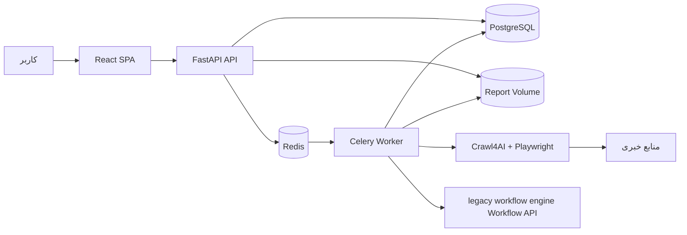

# سند معماری فنی سامانه «رصد و تحلیل»

## 1. مشخصات سند

- نسخه سند: 1.0
- تاریخ تدوین: ۱۴۰۵/۰۳/۱۶ (2026-06-06)
- وضعیت: تأییدشده با شروع فاز دو
- دامنه: معماری نسخه اول محلی

## 2. تصمیم معماری کلان

نسخه اول به‌صورت **مونولیت ماژولار با worker مستقل** پیاده‌سازی می‌شود:

- یک SPA برای رابط کاربری
- یک API برای منطق کسب‌وکار، احراز هویت و دسترسی به داده
- یک worker برای خزش، پاک‌سازی، تحلیل legacy workflow engine و تولید گزارش
- PostgreSQL به‌عنوان منبع حقیقت
- Redis برای صف، cache کوتاه‌مدت و رهگیری موقت وضعیت
- فایل‌سیستم volume برای PDF، Word و فایل‌های موقت
- legacy workflow engine محلی به‌عنوان سرویس خارجی تحلیل شناختی

این ساختار پیچیدگی نسخه اول را پایین نگه می‌دارد، اما پردازش‌های سنگین را از درخواست‌های API جدا می‌کند و امکان تفکیک سرویس‌ها در نسخه‌های بعدی را حفظ می‌کند.

## 3. نمای معماری



## 4. فناوری‌های نهایی

### 4.1. فرانت‌اند

| حوزه | انتخاب |
| --- | --- |
| Runtime ساخت | Node.js 24 در کانتینر |
| چارچوب | React + TypeScript |
| ابزار ساخت | Vite |
| مسیریابی | React Router |
| داده سرور و cache رابط | TanStack Query |
| فرم و اعتبارسنجی | React Hook Form + Zod |
| استایل | Tailwind CSS |
| اجزای رابط | shadcn/ui مبتنی بر Radix UI |
| تاریخ شمسی | کتابخانه دارای پشتیبانی فعال از Jalali، با تبدیل نهایی در API |
| تست واحد | Vitest + React Testing Library |
| تست مرورگر | Playwright |

تصمیم‌های رابط:

- رابط از ابتدا فارسی، `dir="rtl"` و واکنش‌گرا ساخته می‌شود.
- رنگ‌های اصلی طراحی: `#EA7B7B`، `#D25353`، `#9E3B3B` و `#FFEAD3`.
- وضعیت سرور با TanStack Query مدیریت می‌شود؛ state سراسری فقط در صورت نیاز واقعی اضافه خواهد شد.
- jobها در نسخه اول با polling وضعیت به‌روزرسانی می‌شوند و WebSocket خارج از محدوده است.

### 4.2. بک‌اند

| حوزه | انتخاب |
| --- | --- |
| Runtime | Python 3.12 در کانتینر Linux |
| API | FastAPI |
| قرارداد داده | Pydantic v2 |
| تنظیمات | pydantic-settings |
| ORM | SQLAlchemy 2 |
| migration | Alembic |
| درایور PostgreSQL | psycopg 3 |
| درخواست HTTP | HTTPX |
| هش رمز | Argon2id |
| توکن | JWT access + refresh token |
| تست | pytest + pytest-asyncio |

Python میزبان بخشی از قرارداد اجرا نیست؛ توسعه و اجرا از طریق Docker انجام می‌شود تا نسخه Python و وابستگی‌های مرورگر یکسان بمانند.

### 4.3. دیتابیس و ذخیره‌سازی

- PostgreSQL تنها منبع حقیقت سامانه است.
- شناسه‌های اصلی از نوع UUID خواهند بود.
- زمان‌ها در دیتابیس به UTC ذخیره و در رابط کاربری محلی‌سازی می‌شوند.
- بازه شمسی ورودی علاوه بر مقدار نمایشی، به تاریخ میلادی معتبر برای پردازش تبدیل می‌شود.
- فیلدهای منعطف مانند خروجی legacy workflow engine و context لاگ با `JSONB` ذخیره می‌شوند.
- Redis محل نگهداری دائمی داده نیست.
- فایل‌های PDF و Word در volume محلی ذخیره و مسیر و metadata آن‌ها در PostgreSQL ثبت می‌شوند.
- متن پاک‌شده و markdown نگهداری می‌شوند؛ raw HTML به‌صورت پیش‌فرض حداکثر ۷ روز نگهداری و سپس قابل پاک‌سازی است.
- گزارش‌ها و فایل‌های نهایی تا زمان حذف صریح گزارش نگهداری می‌شوند.

### 4.4. صف و پردازش پس‌زمینه

- Celery با Redis به‌عنوان broker و backend موقت استفاده می‌شود.
- API فقط job را ایجاد و در صف قرار می‌دهد.
- worker مراحل خزش، پاک‌سازی، تحلیل و تولید فایل را اجرا می‌کند.
- وضعیت پایدار job در PostgreSQL ثبت می‌شود.
- taskها باید idempotent طراحی شوند تا retry باعث تولید داده تکراری نشود.
- لغو job به‌صورت cooperative و با بررسی وضعیت `cancelled` بین مراحل انجام می‌شود.

مقادیر اولیه قابل تنظیم:

- `max_concurrent_sources = 3`
- `max_concurrent_pages_per_source = 5`
- `connect_timeout = 10s`
- `page_load_timeout = 30s`
- retry شبکه: حداکثر ۲ بار با backoff
- timeout فراخوانی legacy workflow engine: قابل تنظیم، مقدار اولیه ۱۸۰ ثانیه

### 4.5. خزش

- Crawl4AI به‌صورت کتابخانه Python داخل worker استفاده می‌شود.
- Playwright و مرورگر موردنیاز در image مربوط به worker نصب می‌شوند.
- مسیر RSS در اولویت است و سپس صفحه اصلی، آرشیو، دسته‌بندی و sitemap بررسی می‌شوند.
- خزش عمیق و دورزدن CAPTCHA انجام نمی‌شود.
- URLها پیش از درخواست برای جلوگیری از SSRF اعتبارسنجی می‌شوند.
- cache و content hash برای جلوگیری از خزش و تحلیل تکراری استفاده می‌شوند.

### 4.6. اتصال legacy workflow engine

- ارتباط فقط از بک‌اند/worker با legacy workflow engine Workflow API انجام می‌شود.
- `LEGACY_WORKFLOW_ENGINE_BASE_URL`، کلید API و شناسه workflow فقط از environment بک‌اند خوانده می‌شوند.
- کلید legacy workflow engine هرگز به SPA یا پاسخ API ارسال نمی‌شود.
- ورودی و خروجی legacy workflow engine با مدل‌های Pydantic اعتبارسنجی می‌شوند.
- خطاهای موقت retry محدود دارند؛ پاسخ نامعتبر بدون retry بی‌پایان ثبت و گزارش می‌شود.

### 4.7. تولید گزارش

- Word با `python-docx` تولید می‌شود.
- PDF با HTML/CSS و Playwright تولید می‌شود.
- قالب HTML و Word از داده ساختاریافته مشترک تغذیه می‌شوند.
- فونت فارسی به‌صورت محلی در image یا volume پروژه قرار می‌گیرد.
- تست RTL، جدول منابع، شکست صفحه و لینک‌ها بخشی از معیار پذیرش گزارش است.

## 5. مرزبندی ماژول‌های بک‌اند

```text
backend/app/
├── api/             # routeها و dependencyهای HTTP
├── core/            # settings، security، logging و خطاهای مشترک
├── db/              # session، base و migration integration
├── models/          # مدل‌های SQLAlchemy
├── schemas/         # قراردادهای Pydantic
├── repositories/    # دسترسی به داده
├── services/        # منطق کاربردی و orchestration
├── crawlers/        # کشف لینک و خزش
├── processing/      # پاک‌سازی، امتیازدهی و dedupe
├── reports/         # قالب و تولید PDF/Word
├── workers/         # Celery app و taskها
└── tests/
```

قواعد مرزبندی:

- routeها نباید مستقیماً منطق خزش یا query پیچیده اجرا کنند.
- serviceها جریان کاربردی را هماهنگ می‌کنند.
- repositoryها دسترسی پایدار به PostgreSQL را متمرکز می‌کنند.
- worker از همان serviceهای کاربردی استفاده می‌کند تا منطق تکرار نشود.
- قرارداد پاسخ API از مدل دیتابیس جدا نگه داشته می‌شود.

## 6. ساختار پیشنهادی مخزن

```text
/
├── backend/
│   ├── app/
│   ├── migrations/
│   ├── tests/
│   ├── Dockerfile
│   └── pyproject.toml
├── frontend/
│   ├── src/
│   ├── tests/
│   ├── Dockerfile
│   └── package.json
├── docker/
│   └── compose.yml
├── docs/
│   ├── requirements.md
│   ├── architecture.md
│   └── api-spec.md
├── history/
│   └── pouriya.md
├── storage/
│   ├── reports/
│   └── temporary/
├── .env.example
└── README.md
```

## 7. توپولوژی Docker Compose

| سرویس | مسئولیت | دسترسی میزبان |
| --- | --- | --- |
| `frontend` | SPA و dev server در توسعه | بله |
| `api` | FastAPI | بله |
| `worker` | Celery و Crawl4AI | خیر |
| `postgres` | داده پایدار | فقط در توسعه در صورت نیاز |
| `redis` | صف و cache موقت | فقط در توسعه در صورت نیاز |
| `legacy-workflow-engine` | سرویس محلی موجود | از طریق URL تنظیم‌شده |

- `api` و `worker` از کد و تنظیمات مشترک بک‌اند استفاده می‌کنند.
- healthcheck برای API، PostgreSQL و Redis تعریف می‌شود.
- داده PostgreSQL و فایل‌های گزارش در volumeهای پایدار جدا قرار می‌گیرند؛ پایداری Redis برای نسخه اول الزامی نیست.
- اتصال به legacy workflow engine موجود با `host.docker.internal` یا شبکه مشترک Docker، بسته به محل نصب legacy workflow engine، تنظیم می‌شود.

## 8. احراز هویت و امنیت

- access token کوتاه‌عمر است و SPA آن را در حافظه نگه می‌دارد.
- refresh token در cookie از نوع `HttpOnly` و `SameSite=Lax` نگهداری می‌شود.
- refresh tokenها به‌صورت هش‌شده و قابل ابطال در PostgreSQL ثبت می‌شوند.
- API کنترل نقش و مالکیت را در سطح endpoint و service اعمال می‌کند.
- رمزها با Argon2id هش می‌شوند.
- CORS فقط برای originهای تنظیم‌شده فعال است.
- ورودی URL فقط پروتکل‌های `http` و `https` را می‌پذیرد و IPهای داخلی، loopback، metadata endpoint و redirect به آن‌ها را مسدود می‌کند.
- secretها فقط از `.env` محلی یا environment کانتینر خوانده می‌شوند و وارد مخزن نمی‌شوند.

## 9. مشاهده‌پذیری و مدیریت خطا

- لاگ برنامه به‌صورت ساختاریافته در stdout ثبت می‌شود.
- رویدادهای مهم کسب‌وکار و خطاهای قابل نمایش در جدول `system_logs` نگهداری می‌شوند.
- هر درخواست HTTP یک `request_id` و هر اجرای رصد یک `job_id` دارد.
- خطاهای API ساختار یکنواخت شامل `code`، `message` و `details` دارند.
- خطای یک منبع ثبت می‌شود و پردازش سایر منابع تا حد امکان ادامه می‌یابد.

## 10. سیاست API

- مسیر پایه: `/api/v1`
- قراردادها JSON و نام فیلدها انگلیسی هستند؛ متن نمایشی رابط فارسی است.
- مستندات OpenAPI توسط FastAPI تولید می‌شوند.
- pagination برای فهرست کاربران، منابع، jobها و گزارش‌ها اجباری است.
- حذف داده‌های اصلی در صورت داشتن وابستگی، ترجیحاً soft delete یا غیرفعال‌سازی خواهد بود.
- دانلود فایل فقط پس از کنترل دسترسی انجام می‌شود.

## 11. سیاست نسخه و وابستگی‌ها

- نسخه runtimeها در Dockerfile تثبیت می‌شود: Python 3.12 و Node.js 24.
- نسخه دقیق کتابخانه‌ها در lockfile ثبت می‌شود.
- ارتقای major فقط در یک تغییر مستقل و همراه با تست انجام می‌شود.
- imageها و وابستگی‌ها بدون tag یا نسخه شناور در محیط قابل تکرار استفاده نمی‌شوند.
- Crawl4AI در زمان پیاده‌سازی روی یک نسخه پایدار مشخص pin می‌شود؛ استفاده از `latest` مجاز نیست.

## 12. تصمیم‌های ثبت‌شده

| شناسه | تصمیم | دلیل |
| --- | --- | --- |
| ADR-001 | مونولیت ماژولار + worker مستقل | تعادل میان سادگی MVP و جداسازی پردازش سنگین |
| ADR-002 | PostgreSQL به‌جای SQLite | نیاز به صف، هم‌زمانی، JSONB و توسعه آینده |
| ADR-003 | Redis + Celery | اجرای job پس‌زمینه و retry کنترل‌شده |
| ADR-004 | Crawl4AI داخل worker | کنترل مستقیم جریان و جلوگیری از افزودن سرویس غیرضروری |
| ADR-005 | Playwright برای PDF | کنترل بهتر HTML/CSS فارسی و استفاده مجدد از موتور مرورگر |
| ADR-006 | JWT access + refresh cookie | مناسب SPA همراه با امکان ابطال نشست |
| ADR-007 | Docker به‌عنوان قرارداد اجرا | حذف وابستگی به نسخه‌های میزبان و یکسان‌سازی محیط |
| ADR-008 | REST + polling در نسخه اول | سادگی و انطباق با خارج‌بودن WebSocket از محدوده |

## 13. ریسک‌ها و پاسخ معماری

| ریسک | پاسخ |
| --- | --- |
| تفاوت ساختار سایت‌های خبری | adapter و تنظیمات per-source در لایه crawler |
| مصرف بالای مرورگر | محدودیت concurrency و اجرای worker مستقل |
| پاسخ نامعتبر legacy workflow engine | schema validation، ثبت raw response و خطای کنترل‌شده |
| محتوای تکراری | canonical URL، content hash و near-duplicate filtering |
| SSRF از URL منبع | اعتبارسنجی DNS/IP پیش و پس از redirect |
| ناسازگاری خروجی فارسی | قالب مشترک، فونت محلی و تست PDF/Word |
| از دست رفتن وضعیت Redis | نگهداری وضعیت پایدار job در PostgreSQL |

## 14. تعریف پایان فاز یک

فاز یک زمانی پایان‌یافته محسوب می‌شود که این سند تأیید شود. ساخت فایل‌ها، کانتینرها و سرویس‌های واقعی در فاز دو انجام خواهد شد.
