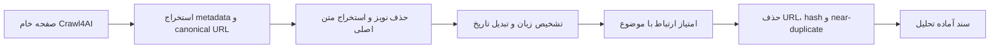

# پاک‌سازی، استخراج و آماده‌سازی محتوا

## وضعیت فاز هفت

- خط آماده‌سازی محتوای خام پیاده‌سازی و با داده کنترل‌شده و سایت واقعی تأیید شده است.
- تبدیل تاریخ شمسی به میلادی در قرارداد ساخت job به‌صورت سمت بک‌اند انجام می‌شود.
- taskهای مستقل آماده‌سازی و task یکپارچه خزش و آماده‌سازی در Celery ثبت شده‌اند.
- فاز هفت در بازبینی نهایی فازهای ۱ تا ۱۷ دوباره در runner جامع تست شد و خروجی آن معتبر است.

## مرز مسئولیت

- worker مسئول پاک‌سازی فنی HTML، استخراج فیلدها، تشخیص زبان، تبدیل تاریخ، امتیازدهی اولیه و حذف تکرار است.
- legacy workflow engine مسئول پاک‌سازی معنایی، کنارگذاشتن خبرهای ضعیف و تحلیل شناختی است.
- ذخیره اسناد آماده‌شده در دیتابیس و اجرای جریان کامل job در فاز جریان رصد انجام می‌شود.

## جریان پردازش

## پاک‌سازی و استخراج

- عناصر `script`، `style`، `nav`، `footer`، `aside`، فرم‌ها و iframe حذف می‌شوند.
- بخش‌های دارای نشانه دقیق تبلیغ، نظر، محتوای پیشنهادی، اشتراک‌گذاری، منو و sidebar حذف می‌شوند.
- متن اصلی با اولویت `article`، سپس `main` و سپس `body` استخراج می‌شود.
- عنوان، نویسنده، منبع، تاریخ انتشار و تصویر شاخص ابتدا از JSON-LD و سپس meta tagها استخراج می‌شوند.
- canonical URL از `link[rel=canonical]` خوانده می‌شود و در نبود آن URL نهایی صفحه استفاده می‌شود.
- متن‌های فارسی با یکسان‌سازی نویسه‌های عربی/فارسی و فاصله‌ها نرمال می‌شوند.

## زبان، تاریخ و ارتباط

- تشخیص سبک و آفلاین زبان‌های `fa`، `ar` و `en` بر اساس خط و نویسه‌های شاخص انجام می‌شود.
- `jdatetime` تبدیل دوطرفه تاریخ شمسی و میلادی را انجام می‌دهد.
- تاریخ انتشار ISO 8601، RFC و تاریخ شمسی قابل تشخیص است و زمان نهایی به UTC تبدیل می‌شود.
- امتیاز ارتباط نسخه اول از پوشش کلمات موضوع در عنوان، متن و URL و فراوانی آن‌ها ساخته می‌شود.
- آستانه طول متن، امتیاز ارتباط و شباهت تکراری‌ها قابل تنظیم است.

## حذف تکرار

ترتیب کنترل تکرار:

1. canonical URL یکسان
2. content hash یکسان روی متن نرمال‌شده
3. شباهت بالای عنوان همراه با شباهت Jaccard متن

## taskهای Celery

| task | کاربرد |
| --- | --- |
| `processing.prepare_pages` | تبدیل فهرست صفحات خام موجود به اسناد آماده |
| `processing.crawl_and_prepare_source` | خزش و آماده‌سازی در یک worker بدون انتقال HTML خام بزرگ در Redis |

## فایل‌ها

- `backend/app/processing/extractor.py`: حذف نویز و استخراج فیلدهای خبر
- `backend/app/processing/text.py`: نرمال‌سازی و تشخیص زبان
- `backend/app/processing/dates.py`: تبدیل و تشخیص تاریخ
- `backend/app/processing/scoring.py`: امتیاز ارتباط
- `backend/app/processing/dedupe.py`: حذف تکرار دقیق و نزدیک
- `backend/app/processing/pipeline.py`: هماهنگ‌سازی پردازش batch
- `backend/app/workers/processing_tasks.py`: taskهای صف
- `backend/scripts/verify_content_processing.py`: آزمون پذیرش تکرارپذیر

## نتایج آزمون

- منو، تبلیغ، نظر و فوتر از HTML کنترل‌شده حذف شدند.
- عنوان، نویسنده، منبع، تاریخ، canonical URL و تصویر شاخص با موفقیت استخراج شدند.
- تشخیص زبان فارسی، عربی و انگلیسی موفق بود.
- تبدیل `۱۴۰۵/۰۳/۱۷` به `2026-06-07` و تبدیل معکوس موفق بود.
- یک سند تکراری حذف و یک سند کوتاه رد شد.
- task واقعی `processing.crawl_and_prepare_source` روی `https://www.python.org` از سه صفحه، دو سند مرتبط آماده و یک صفحه نامرتبط را رد کرد.
