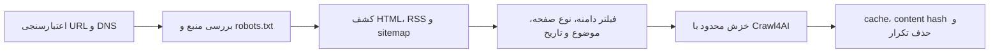

# موتور خزش Crawl4AI

## وضعیت فاز شش

- موتور خزش HTTP و مسیر مرورگر JavaScript/stealth با سایت واقعی و صف Celery تأیید شده‌اند.
- Chromium نسخه Debian داخل image worker نصب شده و از کانال سیستمی `chrome` در Playwright استفاده می‌شود.
- فاز شش در بازبینی نهایی فازهای ۱ تا ۱۷ دوباره در runner جامع تست شد و خروجی آن معتبر است.
- پاک‌سازی عمیق، تشخیص زبان، تبدیل تاریخ و امتیازدهی محتوای صفحه متعلق به فاز هفت است.

## جریان خزش



## کنترل‌های امنیتی و پایداری

- فقط URLهای HTTP و HTTPS عمومی پذیرفته می‌شوند.
- localhost، loopback، IP خصوصی، link-local، multicast، reserved و URL دارای credential رد می‌شوند.
- همه redirectهای مرحله بررسی منبع پیش از دنبال‌شدن دوباره اعتبارسنجی می‌شوند.
- لینک‌ها فقط از host منبع پذیرفته می‌شوند؛ subdomain فقط با تنظیم صریح مجاز است.
- `robots.txt` به‌صورت پیش‌فرض رعایت می‌شود.
- concurrency، timeout، retry و حداکثر تعداد صفحات قابل تنظیم هستند.
- URLهای تکراری در کشف حذف می‌شوند و صفحات دارای content hash تکراری در batch کنار گذاشته می‌شوند.
- cache داخلی Crawl4AI فعال است.
- proxy و undetected browser به‌صورت پیش‌فرض فعال نیستند و استفاده از آن‌ها باید با سیاست منبع سازگار باشد.

## کشف لینک

ترتیب فعلی کشف:

1. صفحه اصلی منبع
2. `/feed`
3. `/rss`
4. `/sitemap.xml`

لینک‌های خارجی، صفحات عمومی غیرخبری مانند login، contact، privacy و advertisement و لینک‌های بدون تطابق موضوع حذف می‌شوند. لینک‌های RSS و sitemap دارای تاریخ، در صورت ارائه بازه زمانی بر اساس تاریخ فیلتر می‌شوند.

## حالت‌های خزش

- `render_javascript=false`: مسیر پیش‌فرض و سبک با `AsyncHTTPCrawlerStrategy`
- `render_javascript=true`: مسیر مرورگر Chromium برای سایت‌های JavaScript‌محور
- `use_stealth=true`: فقط همراه مسیر مرورگر و در صورت مجازبودن سیاست منبع

## taskهای Celery

| task | کاربرد |
| --- | --- |
| `crawler.probe_source` | بررسی دسترسی، redirect، وضعیت HTTP، زمان پاسخ و robots |
| `crawler.crawl_source` | کشف و خزش محدود صفحات مرتبط یک منبع |

نمونه ارسال task:

```python
celery_app.send_task(
    "crawler.crawl_source",
    args=[
        "https://www.python.org",
        "Python",
        {"max_pages": 3, "max_concurrency": 2, "render_javascript": False},
    ],
)
```

## فایل‌ها

- `backend/app/crawler/security.py`: کنترل SSRF و host مجاز
- `backend/app/crawler/discovery.py`: کشف و فیلتر اولیه لینک
- `backend/app/crawler/engine.py`: orchestration و Crawl4AI
- `backend/app/crawler/schemas.py`: قراردادهای داده خزش
- `backend/app/workers/crawler_tasks.py`: taskهای صف
- `backend/scripts/verify_crawler.py`: آزمون امنیت، کشف و خزش واقعی
- `backend/scripts/verify_javascript_crawler.py`: آزمون رندر واقعی JavaScript و مسیر مرورگر موتور

## نتایج آزمون

- URL خصوصی `127.0.0.1` با پیام `URL resolves to a non-public address` رد شد.
- بررسی منبع `https://www.python.org` با پاسخ HTTP 200 و اجازه robots موفق بود.
- آزمون واقعی Crawl4AI سه لینک مرتبط را کشف و هر سه صفحه را همراه content hash خزید.
- task واقعی `crawler.crawl_source` از صف Celery یک لینک را کشف و با موفقیت خزید.
- Chromium سیستمی نسخه `148.0.7778.215` از مسیر استاندارد Playwright اجرا شد.
- آزمون `https://quotes.toscrape.com/js/` محتوای تولیدشده با JavaScript را با موفقیت مشاهده کرد.
- مسیر مرورگر موتور با `render_javascript=true` و `use_stealth=true` موفق بود.
- task مرورگری `crawler.crawl_source` از صف Celery با وضعیت `SUCCESS` یک لینک را کشف و یک صفحه را خزید.
- worker taskهای `crawler.probe_source`، `crawler.crawl_source` و `system.ping` را ثبت کرده است.
