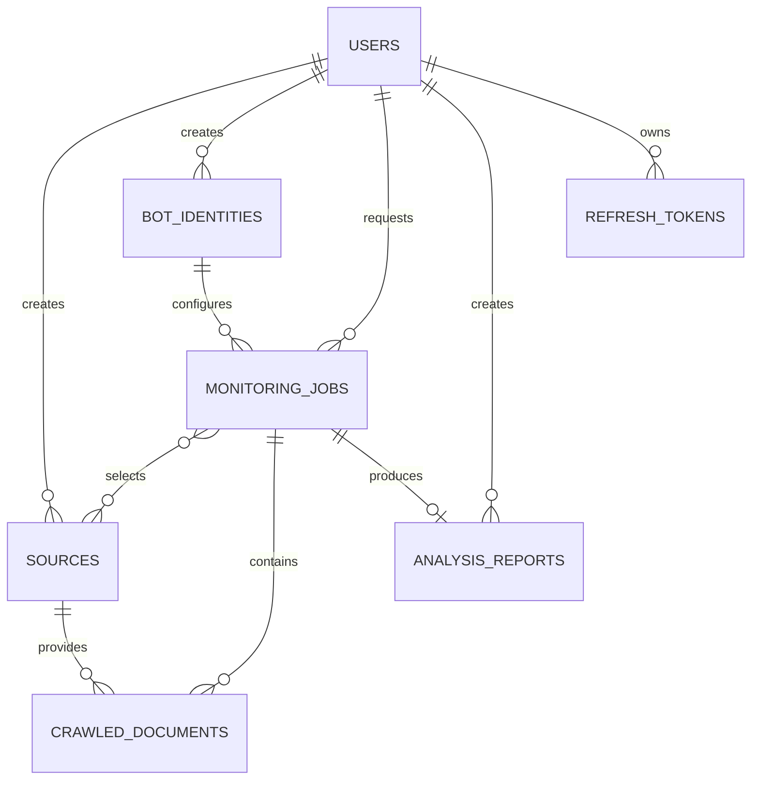

# طراحی دیتابیس سامانه «رصد و تحلیل»

## مشخصات

- نسخه: 1.0
- تاریخ: ۱۴۰۵/۰۳/۱۶ (2026-06-06)
- پایگاه داده: PostgreSQL
- ORM: SQLAlchemy 2
- Migration: Alembic
- وضعیت: پیشنهادی برای تأیید پایان فاز سه

## اصول طراحی

- شناسه اصلی همه موجودیت‌ها UUID است.
- زمان‌ها به‌صورت timezone-aware و UTC ذخیره می‌شوند.
- PostgreSQL منبع حقیقت سامانه است.
- داده‌های منعطف با `JSONB` ذخیره می‌شوند.
- انتخاب منابع هر job رابطه چندبه‌چند است و در جدول واسط ذخیره می‌شود.
- وضعیت‌های محدود با Enum دیتابیس کنترل می‌شوند.
- حذف وابستگی‌های تاریخی مهم با `RESTRICT` و داده‌های کاملاً وابسته با `CASCADE` مدیریت می‌شود.

## جداول

### `users`

حساب کاربران و نقش دسترسی را نگهداری می‌کند.

- نقش‌ها: `super_admin` و `user`
- `username` و `email` یکتا هستند.
- رمز فقط به‌صورت `password_hash` ذخیره می‌شود.

### `refresh_tokens`

نشست‌های قابل ابطال کاربران را نگهداری می‌کند.

- فقط hash توکن ذخیره می‌شود.
- با حذف کاربر، توکن‌های او حذف می‌شوند.

### `sources`

منابع خبری و آخرین نتیجه بررسی اتصال را نگهداری می‌کند.

- انواع: `news_site`، `rss` و `custom_page`
- `base_url` یکتا است.
- `crawl_config` برای تنظیمات ویژه هر منبع استفاده می‌شود.
- زمان پاسخ منفی مجاز نیست.

### `bot_identities`

هویت، لحن، سبک و سیاست تحلیل ربات را نگهداری می‌کند.

- فقط یک هویت می‌تواند `is_default=true` باشد.
- ساختار خروجی و سیاست منابع در `JSONB` نگهداری می‌شوند.

### `monitoring_jobs`

درخواست‌های رصد و وضعیت اجرای آن‌ها را نگهداری می‌کند.

- وضعیت‌ها: `pending`، `crawling`، `processing`، `analyzing`، `completed`، `failed` و `cancelled`
- تاریخ شمسی ورودی و تاریخ میلادی قابل پردازش هر دو ذخیره می‌شوند.
- تاریخ شروع نباید بعد از تاریخ پایان باشد.

### `monitoring_job_sources`

رابط چندبه‌چند jobها و منابع انتخاب‌شده است. این طراحی جایگزین ذخیره `selected_sources` به‌صورت JSON شده تا یکپارچگی ارجاعی حفظ شود.

### `crawled_documents`

اسناد استخراج‌شده از منابع را نگهداری می‌کند.

- هر URL در هر job فقط یک‌بار ذخیره می‌شود.
- `matched_score` در بازه صفر تا یک است.
- `content_hash` و `canonical_url` برای حذف تکرار استفاده می‌شوند.

### `analysis_reports`

گزارش نهایی هر job را نگهداری می‌کند.

- هر job حداکثر یک گزارش دارد.
- گزارش ساختاریافته و snapshot منابع در `JSONB` نگهداری می‌شوند.
- مسیر فایل‌های PDF و Word ثبت می‌شود.

### `system_logs`

رویدادها و خطاهای قابل ردیابی را نگهداری می‌کند.

- سطح‌ها: `debug`، `info`، `warning`، `error` و `critical`
- `request_id` و `job_id` برای correlation قابل ثبت هستند.

## روابط اصلی

## فایل‌های پیاده‌سازی

- مدل‌ها: `backend/app/models/`
- Base و naming convention: `backend/app/db/base.py`
- session async: `backend/app/db/session.py`
- تنظیم Alembic: `backend/alembic.ini` و `backend/migrations/env.py`
- migration اولیه: `backend/migrations/versions/8bc3886485d6_create_initial_schema.py`
- بررسی یکپارچه: `python -m scripts.verify_database`

## معیار پایان فاز سه

- migration اولیه روی PostgreSQL اجرا شود.
- downgrade و upgrade مجدد بدون خطا انجام شوند.
- `alembic check` اختلافی گزارش نکند.
- روابط، Enumها، unique constraintها و check constraintهای کلیدی با داده آزمایشی بررسی شوند.
