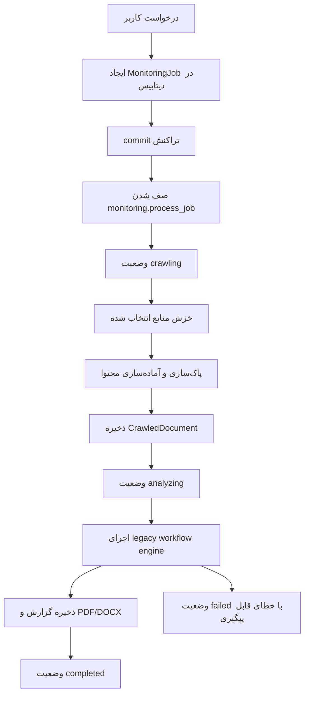

# جریان کامل رصد

این سند در فاز نه پروژه «رصد و تحلیل» ایجاد شد و اکنون مسیر اجرایی یک رصد را از ثبت درخواست تا تحلیل legacy workflow engine و تولید گزارش در معماری ماژولار فعلی توضیح می‌دهد.

## هدف فاز

هدف فاز نه اتصال قطعات ساخته‌شده در فازهای قبلی به یک جریان اجرایی پایدار بود:

1. کاربر موضوع، بازه زمانی، منابع و هویت تحلیلگر را انتخاب می‌کند.
2. بک‌اند یک job پایدار در دیتابیس ایجاد می‌کند.
3. job پس از commit شدن در Celery صف می‌شود.
4. worker منابع انتخاب‌شده را با Crawl4AI می‌خزد.
5. خروجی خام خزش پاک‌سازی، استخراج، امتیازدهی و تکرارزدایی می‌شود.
6. سندهای آماده تحلیل در جدول `crawled_documents` ذخیره می‌شوند.
7. job به وضعیت `analyzing` می‌رسد و workflow تحلیل legacy workflow engine اجرا می‌شود.
8. گزارش ساختاریافته و خروجی‌های PDF/DOCX ذخیره می‌شوند.
9. job در موفقیت به `completed` و در خطای کنترل‌شده به `failed` می‌رسد.

## مرز تاریخی فاز نه و وضعیت فعلی

در پایان فاز نه، وضعیت `analyzing` مرز رسمی جریان بود. این محدودیت تاریخی در فازهای بعد برطرف شد و workflow فعلی تحلیل legacy workflow engine، ذخیره گزارش و تولید PDF/DOCX را نیز ادامه می‌دهد.

## اجزای پیاده‌سازی فعلی

- `app.modules.monitoring.application`: use caseهای lifecycle و workflow مستقل `ProcessMonitoringJob`.
- `app.modules.monitoring.infrastructure`: repository، queue adapter و مراحل زیرساختی pipeline.
- `app.modules.crawling` و `app.modules.documents`: قراردادها، use caseها و adapterهای خزش و آماده‌سازی سند.
- `app.modules.analysis` و `app.modules.reports`: تحلیل legacy workflow engine، persistence گزارش و تولید artifactها.
- `app.bootstrap.monitoring_worker`: Composition Root پردازش پایدار job.
- `app.workers.producer.celery_producer`: producer سبک برای صف کردن task از داخل API بدون import کردن وابستگی‌های سنگین Crawl4AI.
- `app.workers.monitoring_tasks.process_job`: transport adapter با نام عمومی `monitoring.process_job`.
- `app.api.operations.monitoring.MonitoringOperations`: عملیات transport-facing برای ایجاد، مشاهده، ویرایش، retry، لغو و حذف job.
- `scripts.verify_monitoring_flow`: آزمون پذیرش جریان واقعی رصد با دیتابیس، Redis، Celery worker، Crawl4AI و پردازش محتوا.

## جریان وضعیت‌ها



## رفتار لغو

endpoint لغو، status job را به `cancelled` تغییر می‌دهد و `finished_at` را ثبت می‌کند. worker پیش از شروع و میان پردازش منابع وضعیت job را دوباره می‌خواند تا لغو کاربر به صورت cooperative اعمال شود.

## نکات طراحی

- enqueue کردن job پس از `commit` انجام می‌شود تا worker هرگز job ثبت‌نشده را نبیند.
- API فقط producer سبک Celery را import می‌کند. وابستگی‌های Crawl4AI و مرورگر در مسیر API بارگذاری نمی‌شوند.
- `replace_documents` پیش از درج، وجود URL در همان job را بررسی می‌کند تا ذخیره تکراری رخ ندهد.
- تنظیمات خزش و پردازش از `source.crawl_config` خوانده می‌شوند و در نبود تنظیمات، مقدارهای پیش‌فرض schemaها استفاده می‌شود.
- worker در ابتدا و انتهای task اصلی، connection pool دیتابیس را dispose می‌کند تا اجرای پشت‌سرهم taskها با event loopهای جداگانه Celery به اتصال loop قبلی وابسته نشود.

## آزمون پذیرش

دستور اصلی فاز نه:

```powershell
docker compose --env-file .env -f docker/compose.yml --profile worker exec -T worker python -m scripts.verify_monitoring_flow
```

نتیجه ثبت‌شده برای مرز تاریخی فاز نه در تاریخ ۱۴۰۵/۰۳/۱۷:

- job آزمایشی ساخته و در Celery صف شد.
- worker task `monitoring.process_job` را اجرا کرد.
- منبع `https://www.python.org` خزیده شد.
- دو سند آماده در دیتابیس ذخیره شد.
- job با status برابر `analyzing` متوقف شد.
- آزمون پس از اصلاح pool دیتابیس worker دو بار پشت‌سرهم اجرا شد و هر دو بار با موفقیت به `analyzing` رسید.

## بررسی‌های همراه

برای اطمینان از اینکه فاز نه قطعات قبلی را نشکسته است، این بررسی‌ها نیز با موفقیت اجرا شدند:

```powershell
docker compose --env-file .env -f docker/compose.yml exec -T api python -m scripts.verify_openapi
docker compose --env-file .env -f docker/compose.yml exec -T api python -m scripts.verify_database
docker compose --env-file .env -f docker/compose.yml exec -T api alembic check
docker compose --env-file .env -f docker/compose.yml --profile worker exec -T worker celery -A app.workers.celery_app:celery_app inspect registered
docker compose --env-file .env -f docker/compose.yml --profile worker exec -T worker python -m scripts.verify_crawler
docker compose --env-file .env -f docker/compose.yml --profile worker exec -T worker python -m scripts.verify_content_processing
docker compose --env-file .env -f docker/compose.yml --profile worker exec -T worker python -m scripts.verify_javascript_crawler
```

در وضعیت فعلی، taskهای `monitoring.process_job`، `crawler.probe_source`، `crawler.crawl_source`، `processing.prepare_pages`، `processing.crawl_and_prepare_source` و `system.ping` ثبت می‌شوند.

## کارهای تاریخی منتقل‌شده و وضعیت آن‌ها

- اتصال `analyzing` به legacy workflow engine و ذخیره گزارش در فاز ده تکمیل شد.
- تولید PDF و Word در فاز یازده تکمیل شد.
- احراز هویت، کنترل نقش و کنترل مالکیت endpointها تکمیل و با `verify_security` پوشش داده شده است.
