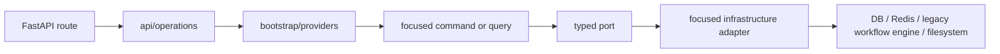

# Phase 8 — Final responsibility boundaries

Phase 8 removes the remaining public god-adapter boundaries while preserving HTTP paths,
OpenAPI response models, database schema, Celery task names, and report output behavior.

## Enforced boundaries

- Every bounded context exposes a small `api.py` public surface.
- Application, domain contracts, and public ports do not use `Any` and do not import ORM or
  transport schemas.
- Transport operations live under `app/api/operations`; bootstrap only assembles dependencies.
- Source, bot-identity, and report reads and writes use separate query/command adapters.
- Monitoring orchestration belongs to `ProcessMonitoringJob`, while
  `MonitoringPipelineSteps` implements the focused infrastructure steps.
- Analysis orchestration is scoped as `AnalysisJobCoordinator`; the external legacy workflow engine request runs
  after the active database transaction is released.
- Model-provider consumers use `provider_queries` or `provider_commands`. The legacy workflow engine protocol
  implementation is private in `_provider_backend.py`, and `model_providers.py` is only a
  backward-compatible import shim.
- Expected failures use the shared domain error hierarchy and are translated once at the HTTP
  boundary.

The final completion removed the temporary `MonitoringOperationsAdapter`. HTTP monitoring now
receives focused query and command use cases from `bootstrap/providers.py`; output cleanup depends
only on Documents and Reports ports. The durable worker receives repository, document persistence,
analysis coordinator, mapper, session, and database-disposal factories from its composition root.

System connection and health operations no longer create SQLAlchemy sessions, Redis clients,
HTTPX clients, or runtime-setting integrations. Focused infrastructure probes and settings adapters
are assembled in bootstrap and injected into transport operations.

Architecture tests prevent restoration of `bootstrap/operations.py`, the removed god-adapter
class names (including `MonitoringOperationsAdapter`), `Any` in public contracts, framework imports
in application code, cross-module infrastructure imports, direct infrastructure access from HTTP
routes or Celery tasks, and construction of external I/O inside transport operations.

## Verification record

- Ruff and Python compilation: passed.
- Test suite: 55 passed, 2 skipped.
- Alembic migration, database, OpenAPI (24 paths / 33 operations), security, observability,
  professional features, PDF/DOCX exports, content processing, performance, and legacy workflow engine adapter:
  passed in Docker.
- Deterministic Celery monitoring flow: passed with one persisted document and the expected
  failure boundary when legacy workflow engine is intentionally unconfigured.
- The live external crawler probe and one live legacy workflow engine/OpenRouter monitoring run remain dependent
  on external network availability; both internal deterministic boundaries were verified.
