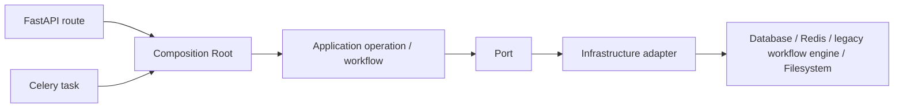
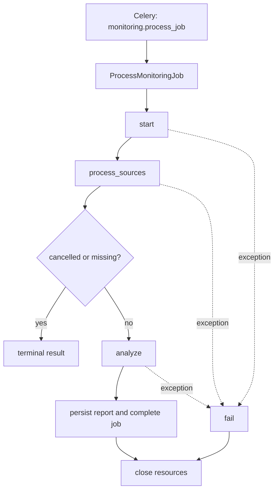

# معماری هدف بازطراحی

این سند قرارداد انتقال تدریجی از ساختار legacy به ماژول‌های مستقل را تعریف می‌کند. ایجاد این ساختار به‌تنهایی رفتار برنامه را تغییر نمی‌دهد.

خط مبنای تاریخی، جریان‌های اجرایی، impact map، ریسک‌ها و برنامه rollback در
[`refactoring-phase-0-baseline.md`](refactoring-phase-0-baseline.md) ثبت شده‌اند.

## لایه‌ها و جهت وابستگی

```text
entrypoints (api / workers) -> application -> domain
                                   -> ports <- infrastructure
```

- `entrypoints` فقط ورودی HTTP یا task را به use case تبدیل و نتیجه را به response/task result تبدیل می‌کنند.
- `application` یک عملیات کسب‌وکاری را هماهنگ می‌کند و فقط به domain و portها وابسته است.
- `domain` شامل entity، value object و policy است و از framework، persistence، شبکه و فایل‌سیستم مستقل می‌ماند.
- `ports` قراردادهای لازم application با بیرون از ماژول را تعریف می‌کنند.
- `infrastructure` پیاده‌سازی portها با SQLAlchemy، Celery، Crawl4AI، HTTPX، legacy workflow engine و filesystem است.

## قواعد import

1. `shared/domain` نباید FastAPI، Celery، SQLAlchemy، HTTPX، asyncpg یا `app.db`، `app.api`، `app.workers`، `app.services` و `app.models` را import کند.
2. `application` نباید مستقیم framework، ORM، queue، HTTP client یا filesystem را import کند.
3. `infrastructure` می‌تواند domain، application و portهای ماژول خود را import کند.
4. ارتباط میان ماژول‌های کسب‌وکاری فقط با contract application، port یا domain event صریح انجام می‌شود؛ import مستقیم infrastructure ماژول دیگر ممنوع است.
5. مدل‌های SQLAlchemy در `app/models` تا پایان مهاجرت، مدل persistence legacy هستند و نباید در این فاز جابه‌جا شوند.

## وضعیت legacy و مقصد انتقال

| ساختار فعلی | مقصد مرحله‌ای |
| --- | --- |
| `app/services/monitoring_flow.py` | `modules/monitoring` |
| `app/crawler` | `modules/crawling` |
| `app/processing` | `modules/documents` |
| `app/services/legacy-workflow-engine_analysis.py` | `modules/analysis` و `modules/reports` |
| `app/reports` | `modules/reports` |
| `app/services/model_providers.py` | `modules/platform_settings` |
| `app/api` و `app/workers` | entrypointهای نازک در پایان مهاجرت |

## وضعیت انتقال Monitoring

فاز دوم، lifecycle و عملیات Job را به `modules/monitoring` منتقل می‌کند:

- `domain/lifecycle.py`: transitionهای مجاز و زمان‌های lifecycle.
- `application/use_cases.py`: ایجاد، مشاهده، فهرست، ویرایش، retry، لغو، حذف و تغییر وضعیت Job.
- `infrastructure/repository.py`: queryهای SQLAlchemy مربوط به MonitoringJob.
- `infrastructure/queue.py`: صف‌کردن task فعلی Celery.
- `app/services/monitoring_flow.py`: facade سازگاری برای callerهای legacy.

ذخیره و query سندهای خزیده‌شده از فاز سوم از طریق use case و repository ماژول Documents
انجام می‌شود. پاک‌سازی فایل خروجی گزارش نیز در فازهای بعدی به storage ماژول Reports منتقل شد.

### تکمیل نهایی فاز دوم

- `MonitoringJobRepository.get_processable` مرز ورود worker را فقط به Jobهای `pending`
  محدود می‌کند.
- بارگذاری Job در مراحل میانی workflow از `get_by_id` استفاده می‌کند تا ادامه مراحل
  `crawling` و `analyzing` با ورود اولیه صف مخلوط نشود.
- `StartMonitoringJob` مسیر واقعی شروع Job است و transition به `crawling` را از طریق
  lifecycle policy انجام می‌دهد.
- تست‌ها لغو Job فعال و `finished_at`، مسیر `processing → analyzing`، ممنوع‌بودن تکمیل
  مستقیم از processing، use case شروع و query فیلترشده را پوشش می‌دهند.

## وضعیت انتقال Crawling و Documents

فاز سوم دو مرز مستقل اضافه می‌کند:

- `modules/crawling`: قرارداد `CrawlRequest/CrawlOutcome`، port خزش، use caseهای crawl/probe و adapter سازگار با `CrawlEngine`.
- `modules/documents`: قرارداد آماده‌سازی سند، processor port، repository سند و use caseهای prepare/persist/count.

`CrawlEngine` و `ContentProcessor` هنوز implementationهای legacy مرجع هستند. adapterها برای حفظ امنیت URL، robots.txt، discovery، rendering JavaScript، پاک‌سازی، تاریخ، relevance و dedupe به آن‌ها delegate می‌کنند. مسیر سازگاری Monitoring فقط به use caseهای ذخیره و شمارش سند delegate می‌کند؛ worker در این فاز بدون تغییر عمده باقی می‌ماند.

### تکمیل نهایی فاز سوم

- خروجی Crawling اکنون فقط داده خام و typed شامل نتیجه probe، لینک‌های کشف‌شده، صفحه‌ها،
  زمان شروع و پایان و خطاهای منبع است؛ هیچ مدل ORM یا مسئولیت lifecycle در این ماژول وجود ندارد.
- `BuildCrawlRequest` ساخت command مستقل را بر عهده دارد و آداپتر Crawl4AI مدل‌های legacy را
  با نگاشت صریح به قراردادهای domain تبدیل می‌کند.
- ورودی و خروجی Documents با `RawDocumentPage`، `PreparedDocumentRecord` و
  `RejectedDocumentRecord` از Pydantic، SQLAlchemy و pipeline قدیمی مستقل شده‌اند.
- `ContentProcessorAdapter` فقط آماده‌سازی محتوا را انجام می‌دهد و
  `SqlAlchemyDocumentRepository` فقط dedupe پایگاه‌داده، ذخیره batch، شمارش و پاک‌سازی را.
- مسیر سازگاری Monitoring پیش از persistence مدل legacy را به record مستقل Documents نگاشت
  می‌کند؛ بنابراین وابستگی مستقیم به pipeline پردازش وارد startup تصویر API نمی‌شود.
- تست‌های مستقل use case، نگاشت آداپتر، قرارداد duplicate repository و قواعد import معماری
  مرزهای این فاز را تثبیت می‌کنند.

## وضعیت انتقال Analysis و Reports

فاز چهارم قراردادهای `AnalysisRequest/AnalysisOutcome` و `ReportExportRequest` را اضافه می‌کند. gateway تحلیل و renderer/storage گزارش پشت portهای مستقل قرار می‌گیرند. legacy workflow engine client و rendererهای PDF/DOCX فعلی همچنان implementationهای legacy مرجع هستند تا انتقال کامل transport، persistence و rendering بدون تغییر خروجی در فازهای بعدی ادامه یابد.

### تکمیل نهایی فاز چهارم

- خروجی legacy workflow engine در `legacy workflow engineWorkflowGateway` به DTOهای مستقل Analysis نگاشت می‌شود؛ domain دیگر
  به `model_dump`، URLهای Pydantic یا schemaهای legacy workflow engine وابسته نیست.
- `RunAnalysis` تنها اجرای gateway را هماهنگ می‌کند و client موجود legacy workflow engine مسئول transport،
  retry و validation پاسخ باقی مانده است.
- `LegacyReportRenderer` فقط PDF یا DOCX را به bytes تبدیل می‌کند و
  `LocalReportFileStorage` فقط ذخیره و حذف امن artifact را انجام می‌دهد.
- تولید تک‌فرمت و دوفرمت از `GenerateReportExport` عبور می‌کند؛ مسیر تحلیل و دانلود دیگر
  generator قدیمی را خارج از port/use case فراخوانی نمی‌کنند.
- وابستگی مستقیم infrastructure ماژول Analysis به infrastructure ماژول Reports حذف و
  اتصال repository/exporter در `bootstrap/analysis.py` انجام می‌شود.
- API عمومی Reports قابل import است و نام use case عمومی با implementation یکسان است.
- تست‌های import عمومی، منع وابستگی Analysis↔Reports infrastructure، نگاشت legacy workflow engine، قرارداد
  renderer/storage و سناریوهای واقعی legacy workflow engine و PDF/DOCX از این مرزها محافظت می‌کنند.

## روش انتقال

هر فاز ابتدا port و interface را می‌افزاید، سپس implementation را کنار legacy قرار می‌دهد، callerها را جابه‌جا می‌کند و در پایان کد legacy را تنها پس از پوشش تست حذف می‌کند.

## وضعیت نهایی فاز ۵: مرزبندی Persistence

فاز ۵ تکمیل شده است. دسترسی به پایگاه‌داده و فایل‌سیستم از سرویس‌های سازگاری خارج و در adapterهای زیر متمرکز شده است:

- repositoryهای SQLAlchemy برای job، source، document، report، user، bot identity و system log؛
- read modelهای مستقل برای dashboard، system log و analysis job؛
- `LocalReportFileStorage` برای ایجاد، بررسی و حذف امن فایل‌های گزارش؛
- facadeهای legacy فقط برای حفظ قرارداد API و worker باقی مانده‌اند و عملیات مستقیم `session.*` انجام نمی‌دهند.

### تکمیل نهایی قراردادهای فاز پنجم

- repositoryهای User، Source، MonitoringJob، Document، Report، BotIdentity و SystemLog همگی
  port مالک و implementation قابل جایگزینی SQLAlchemy دارند.
- operationهای Identity، Source و BotIdentity repository concrete را داخل خود ایجاد نمی‌کنند؛
  implementationها در Composition Root ساخته و از طریق قرارداد تزریق می‌شوند.
- `AnalysisJobReader`، `DashboardReader` و `SystemLogReader` قرارداد read-only مستقل دارند و
  adapterهای SQLAlchemy آن‌ها از callerهای transport جدا هستند.
- قراردادهای persistence و read modelها `runtime_checkable` هستند و تست تطابق، وجود همه
  متدهای مورد انتظار را برای هفت repository، سه reader و file storage کنترل می‌کند.
- هیچ migration یا schema جدیدی در تکمیل این فاز ایجاد نشده است و Alembic همچنان روی head
  مصوب پروژه قرار دارد.

قواعد این مرز با تست معماری enforce می‌شوند. تست‌های واحد، migration، OpenAPI، امنیت، observability، legacy workflow engine adapter، خروجی PDF/DOCX، قابلیت‌های حرفه‌ای، crawler، content processing و جریان Celery/worker اجرا شده‌اند. تست worker به‌صورت deterministic تا مرز تحلیل خارجی اجرا می‌شود تا نتیجه آن به در دسترس بودن legacy workflow engine/OpenRouter وابسته نباشد.

## وضعیت نهایی فاز ۶: Entry Point و Composition Root

فاز ششم ساخت dependencyها، مرز transaction و اتصال transport به application را در `app/bootstrap` متمرکز می‌کند. routeهای FastAPI و taskهای Celery دیگر session، repository، crawler، legacy workflow engine client یا service facade نمی‌سازند.



### مرز تراکنش

- `TransactionRunner` هر command را در یک مرز commit/rollback اجرا می‌کند و فقط به قرارداد `UnitOfWork` وابسته است؛ `SqlAlchemyUnitOfWork` در Composition Root ساخته و تزریق می‌شود.
- routeها و taskها مجاز به اجرای commit یا rollback نیستند.
- queryهای read-only بدون commit اضافی اجرا می‌شوند.
- enqueue کردن Monitoring Job فقط پس از commit موفق انجام می‌شود.

### مسیر HTTP

route فقط ورودی و Principal را دریافت می‌کند، operation مربوط به دامنه را از provider متمرکز bounded context خود در `app/bootstrap/providers.py` می‌گیرد و DTO خروجی را برمی‌گرداند. خطاهای مورد انتظار به خطاهای مشترک domain تبدیل و توسط `domain_exception_handler` به HTTP status مناسب نگاشت می‌شوند.

### مسیر Worker

نام taskهای عمومی Celery حفظ شده است. فایل‌های `app/workers/*_tasks.py` فقط transport adapter هستند و اجرا را به operationهای ساخته‌شده در bootstrap واگذار می‌کنند. `ProcessMonitoringJob` یک workflow مستقل از Celery است و پردازنده فعلی از طریق `MonitoringJobProcessor` به آن تزریق می‌شود.

Composition Rootهای `crawler_worker.py` و `processing_worker.py` اجرای اصلی را از طریق use caseهای
`ProbeSource`، `CrawlSource` و `PrepareDocuments` انجام می‌دهند. ساخت adapterهای Crawl4AI و پردازش
محتوا فقط در factoryهای bootstrap انجام می‌شود و شکل JSON خروجی و نام taskهای عمومی قبلی حفظ شده است.

### وضعیت facadeهای سازگاری

`MonitoringFlowService`، `legacy workflow engineAnalysisService`، `ReportService`، `SourceService`، `AuthService`، `AdminUserService`، `BotIdentityService`، `DashboardService` و `SystemLogService` دیگر caller مستقیم در API یا Celery ندارند. آن‌ها موقتاً adapterهای سازگاری داخل Composition Root هستند تا انتقال DTOها و مدل‌های persistence در فاز بعد بدون شکستن قرارداد عمومی تکمیل شود.

### قواعد enforce‌شده

- routeهای HTTP نباید SQLAlchemy، `app.db`، serviceهای legacy یا infrastructure ماژول‌ها را import کنند.
- taskهای Celery نباید SQLAlchemy، database، service، crawler یا processor را مستقیماً import کنند.
- application layer همچنان از FastAPI، Celery، SQLAlchemy و filesystem مستقل است.
- سرویس‌های سازگاری اجازه اجرای مستقیم عملیات `session.*` ندارند.

بدهی فنی منتقل‌شده به فاز بعد، حذف کامل adapterهای سازگاری پس از انتقال mapperهای transport و DTOهای legacy است؛ این بدهی در callerهای اصلی حضور ندارد و با تست مرز معماری کنترل می‌شود.

### تکمیل و شواهد پذیرش فاز ششم

- تست معماری از import مستقیم `app.crawler` و `app.processing` در Composition Rootهای worker جلوگیری می‌کند.
- تست‌های worker با adapterهای fake عبور داده شدن probe، crawl و prepare از use caseهای application و
  ثابت ماندن قرارداد خروجی Celery را کنترل می‌کنند.
- تست تراکنش ترتیب `operation -> commit -> enqueue` را تضمین می‌کند و در سناریوی شکست commit،
  rollback و enqueue نشدن job را بررسی می‌کند.
- queryهای read-only خارج از `TransactionRunner` باقی مانده‌اند و route/task هیچ commit یا rollback
  مستقیمی اجرا نمی‌کند.

## وضعیت نهایی فاز ۷: حذف Facadeهای Legacy

Facadeهای `AuthService`، `AdminUserService`، `SourceService`، `BotIdentityService`، `DashboardService`، `SystemLogService`، `MonitoringFlowService`، `legacy workflow engineAnalysisService` و `ReportService` حذف شده‌اند و هیچ تعریف یا caller فعالی ندارند. تست AST از بازگشت این نام‌ها جلوگیری می‌کند.

مالکیت implementationها اکنون چنین است:

| مسئولیت | ماژول مالک |
| --- | --- |
| Identity و Refresh Token | `modules/identity` |
| Source و Probe | `modules/crawling` |
| Bot Identity، Dashboard و System Log | `modules/monitoring` |
| legacy workflow engine client و Analysis workflow | `modules/analysis` |
| Report query/export/storage | `modules/reports` |
| Runtime settings و Model Provider | `modules/platform_settings` |

### Composition Root متمرکز اما غیرعمومی

`ApplicationContainer` عمومی حذف شده است. هر route فقط provider متمرکز بر bounded context خود را از `app/bootstrap/providers.py` دریافت می‌کند؛ بنابراین ساخت dependencyهای غیرمرتبط برای هر درخواست انجام نمی‌شود. `container.py` فقط marker مربوط به composition root است، transaction در `transaction.py` و operationهای transport-facing در `operations.py` نگهداری می‌شوند.

### Monitoring Pipeline



Application workflow ترتیب مراحل، terminal result، failure و cleanup را مدیریت می‌کند. adapter زیرساختی هر مرحله را در متد مستقل اجرا می‌کند. session یا transaction فعال پیش از crawl و تماس طولانی legacy workflow engine آزاد می‌شود و persistence هر مرز به‌صورت صریح commit می‌شود.

### DTO، Mapper و مرز لایه‌ها

- application layer هیچ importی از `app.models`، `app.schemas`، FastAPI، Celery، SQLAlchemy، HTTPX یا filesystem ندارد.
- mapperهای خروجی User، Source، Monitoring Job و Report در مرز adapter قرار دارند و I/O انجام نمی‌دهند.
- مدل‌های SQLAlchemy فقط در infrastructure و bootstrap adapterهای فنی دیده می‌شوند.
- taskهای Celery فقط ثبت task و فراخوانی workflow ساخته‌شده را انجام می‌دهند.

### کنترل بدهی فنی

فایل integration مربوط به Model Provider به دلیل وابستگی هم‌زمان به legacy workflow engine DB و plugin storage پرریسک است. مالکیت آن به `modules/platform_settings/infrastructure` منتقل شده و routeها فقط operationهای محدود update/activate/delete را می‌بینند. شکستن جزئیات داخلی plugin installation باید بدون تغییر قرارداد legacy workflow engine در یک تغییر مستقل انجام شود.

### شواهد تکمیل فاز هفتم

- هیچ تعریف، import یا caller فعالی از facadeهای legacy در کد Python وجود ندارد و تست AST از بازگشت آن‌ها جلوگیری می‌کند.
- `ApplicationContainer` عمومی caller ندارد و routeها provider متمرکز bounded context خود را دریافت می‌کنند.
- تست‌های معماری، lifecycle مانیتورینگ، OpenAPI، امنیت و ثبت taskهای Celery پس از حذف facadeها عبور کرده‌اند.
- اسناد عملیاتی legacy workflow engine، جریان Monitoring، خروجی گزارش و observability به مسیرهای ماژولار فعلی به‌روزرسانی شده‌اند و اشاره فعال به `app.services` ندارند.

## وضعیت نهایی فاز ۸: مرزبندی نهایی مسئولیت‌ها

- facade موقت `MonitoringOperationsAdapter` حذف شده است؛ مسیر HTTP مستقیماً query/command use caseهای
  Monitoring را از Composition Root دریافت می‌کند.
- پاک‌سازی اسناد و report artifactها در `MonitoringOutputCleaner` متمرکز شده و فقط به portهای
  Documents و Reports وابسته است.
- `MonitoringPipelineSteps` dependencyهای persistence، analysis، mapper، session و cleanup اتصال
  دیتابیس را از `bootstrap/monitoring_worker.py` دریافت می‌کند و دیگر dependency concrete ماژول‌های
  دیگر یا bootstrap را import نمی‌کند.
- عملیات Health و System Connections هیچ Session، Redis client، HTTPX client یا runtime integration
  نمی‌سازند؛ probeها و adapterهای متمرکز در bootstrap تزریق می‌شوند.
- مسیرهای production مربوط به Monitoring، Crawling، Documents، Analysis و Reports از API عمومی
  ماژول مربوط استفاده می‌کنند و هر هفت `modules/*/api.py` قابل import هستند.
- تست معماری از بازگشت God Adapterها، ساخت external I/O در transport operation، import متقابل
  infrastructure ماژول‌ها و حذف APIهای عمومی جلوگیری می‌کند.
- قرارداد HTTP، ۲۴ path و ۳۳ operation در OpenAPI، schema دیتابیس، نام taskهای Celery و رفتار
  خروجی گزارش بدون تغییر حفظ شده‌اند.
