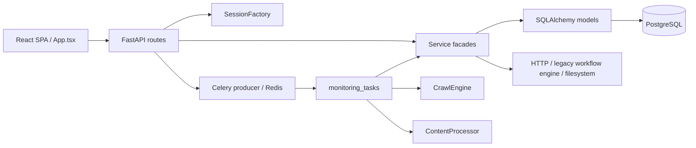

# فاز صفر بازطراحی معماری — خط مبنا و قرارداد مهاجرت

## 1. هدف، زمان و روش بررسی

این سند خروجی کامل فاز صفر بازطراحی معماری است. هدف آن ثبت وضعیت پروژه **پیش از
شروع بازطراحی** است؛ بنابراین توصیف‌های این سند به snapshot اولیه کد و گزارش ثبت‌شده
در task بازطراحی مربوط‌اند، نه ساختار فعلی پس از فاز هشتم.

- نوع فاز: صرفاً تحلیل و مستندسازی
- شاخه در زمان بررسی اولیه: `master`
- وضعیت workspace: دارای تغییرات محلی متعلق به کاربر
- روش استخراج: مستندات `docs/*.md`، snapshot موجود در Git و تحلیل ایستای importها و callerها
- گراف وابستگی repository در زمان بررسی و هنگام تکمیل این سند در دسترس نبود
- تغییر رفتار، migration، Docker، env و dependency در این فاز: هیچ‌کدام

فایل‌های حساس دارای تغییر محلی در زمان بررسی اولیه شامل موارد زیر بودند و خارج از
دامنه تغییر فاز صفر نگه داشته شدند:

- `backend/app/services/monitoring_flow.py`
- `backend/app/services/legacy-workflow-engine_analysis.py`
- `backend/app/workers/monitoring_tasks.py`
- `backend/app/reports/generator.py`
- `frontend/src/App.tsx`
- `frontend/src/styles.css`

## 2. ساختار و معماری واقعی خط مبنا



### اجزای اصلی

| بخش | مسیر خط مبنا | نقش واقعی |
| --- | --- | --- |
| Frontend | `frontend/src/App.tsx` | SPA، state، فراخوانی API و نمایش اغلب قابلیت‌ها در یک فایل |
| HTTP | `backend/app/api/routes` | route، ساخت session، commit و تبدیل exception به HTTP |
| Services | `backend/app/services` | use case، query، persistence، mapper و gateway بیرونی |
| Worker | `backend/app/workers` | ثبت Celery task و orchestration/اجرای مستقیم فرایند |
| Persistence | `backend/app/models` و `SessionFactory` | ORM مشترک و دسترسی مستقیم از route/service/worker |
| Crawling | `backend/app/crawler` | probe، security، discovery، robots و اجرای Crawl4AI |
| Documents | `backend/app/processing` | extraction، تاریخ، scoring، زبان، topic و dedupe |
| Reports | `backend/app/reports/generator.py` | قالب و تولید PDF/DOCX و نوشتن فایل |
| Runtime | `docker/compose.yml` | frontend، API، worker، PostgreSQL و Redis |

در خط مبنا repository layer واقعی وجود نداشت. مدل‌های ORM و `AsyncSession` مستقیماً
در serviceها مصرف می‌شدند و routeها نیز transaction را مدیریت می‌کردند. این وضعیت با
معماری پیشنهادی سند قدیمی پروژه که repository مستقل را پیش‌بینی کرده بود، هم‌خوان نبود.

## 3. جدول جریان‌های اجرایی خط مبنا

| جریان | Entry point | هماهنگ‌کننده/منطق | Persistence | وابستگی خارجی | خروجی |
| --- | --- | --- | --- | --- | --- |
| ورود و احراز هویت | `api/routes/auth.py`: `login`, `refresh`, `logout`, `me`, `update_profile`, `change_password` | `AuthService`؛ اعتبارسنجی رمز، صدور و rotation توکن، mapper کاربر | `User`, `RefreshToken` با `AsyncSession`؛ commit در route | JWT/password hashing | `TokenResponse`, `UserSummary` یا HTTP error |
| مدیریت منابع | `api/routes/sources.py` | `SourceService`؛ CRUD، URL validation، probe و mapper | `Source`؛ query/flush در service و commit در route | HTTPX و اعتبارسنجی SSRF | فهرست/جزئیات منبع و نتیجه health check |
| ساخت/مشاهده/لغو Job | `api/routes/monitoring.py` | `MonitoringFlowService`؛ CRUD، مجوز، lifecycle، پاک‌سازی خروجی و enqueue | `MonitoringJob`, `Source`, `BotIdentity`, `CrawledDocument`, `AnalysisReport` | Celery producer و filesystem گزارش | `MonitoringJobRead`، پیام retry/cancel/delete |
| اجرای worker | Celery task با نام عمومی `monitoring.process_job` در `workers/monitoring_tasks.py` | `_process_job`؛ cancellation، crawl، process، coverage، status، log، analysis و failure | sessionهای مستقیم و `MonitoringFlowService` | Redis/Celery، Crawl4AI، HTTP، legacy workflow engine و filesystem | status نهایی Job، اسناد و Report |
| خزش و کشف URL | taskهای `crawler.probe_source` و `crawler.crawl_source` یا فراخوانی worker | `CrawlEngine`: safe request، robots، sitemap/search، discovery و crawl page | بدون persistence مستقیم؛ نتیجه به caller برمی‌گردد | HTTPX، Crawl4AI/Playwright، وب‌سایت منبع | `SourceProbe` یا `CrawlBatchResult` |
| پردازش و dedupe | taskهای `processing.prepare_pages` و `processing.crawl_and_prepare_source` یا worker اصلی | `ContentProcessor` به‌همراه extractor، scoring، date، language، topic و dedupe | worker از طریق `MonitoringFlowService.replace_documents` ذخیره می‌کند | محاسبات محلی؛ ورودی از crawler | اسناد آماده و موارد ردشده |
| تحلیل legacy workflow engine و ذخیره گزارش | worker → `legacy workflow engineAnalysisService.analyze_job` | ساخت input، انتخاب اسناد، translation policy، retry، parse/validation، ذخیره report و تکمیل Job | `MonitoringJob`, `CrawledDocument`, `AnalysisReport` | HTTPX → legacy workflow engine Workflow | Report ذخیره‌شده و وضعیت `completed` یا `failed` |
| PDF/DOCX | routeهای download در `api/routes/reports.py` → `ReportService.export_path` | `ReportService` + `ReportExportGenerator`؛ کنترل دسترسی، lazy generation و حذف فایل | `AnalysisReport` و مسیر فایل در DB؛ commit در route | filesystem، ReportLab و python-docx | `FileResponse` برای PDF/DOCX |
| داشبورد، لاگ و مشاهده‌پذیری | `api/routes/dashboard.py`, `api/routes/system_logs.py` و middleware | `DashboardService`, `SystemLogService`, `record_system_log` | aggregate/query روی User/Source/Job/Report/BotIdentity/SystemLog | logging runtime | `DashboardSummary`، فهرست لاگ و request id |

Frontend در خط مبنا endpointهای `/auth`، `/sources`، `/bot-identities`،
`/monitoring/jobs`، `/reports`، `/system/logs` و `/system/connections` را مستقیماً
از `App.tsx` فراخوانی می‌کرد؛ بنابراین تغییر قرارداد HTTP دارای اثر مستقیم روی SPA بود.

## 4. ابرابژه‌ها و نقض مرز مسئولیت

اندازه‌ها از گزارش اولیه فاز صفر ثبت شده‌اند و ممکن است با snapshotهای Git بعدی چند خط
اختلاف داشته باشند.

| فایل / symbol | مسئولیت‌های تجمیع‌شده | وابستگان اصلی | ریسک | مقصد پیشنهادی |
| --- | --- | --- | --- | --- |
| `services/model_providers.py`، حدود 1656 خط | رمزنگاری، دو DB مربوط به legacy workflow engine، plugin install، sync workflow، provider CRUD و runtime settings | routeهای system connection، legacy workflow engine analysis و DBهای داخلی legacy workflow engine | بسیار بالا | `modules/platform_settings` با query/command و gatewayهای مستقل |
| `ReportExportGenerator`، حدود 648 خط | تبدیل داده، RTL، فونت، layout، PDF، DOCX و filesystem | `legacy workflow engineAnalysisService`, `ReportService` و verify export | بالا | rendererهای PDF/DOCX و file storage جدا در `modules/reports` |
| `legacy workflow engineAnalysisService`، حدود 562 خط | load/validate، input builder، legacy workflow engine client/retry، persistence، lifecycle Job و export | monitoring worker، report API و تست legacy workflow engine | بالا | application analysis، legacy workflow engine gateway، report repository و exporter |
| `MonitoringFlowService`، حدود 327 خط | CRUD، authorization، lifecycle، queue، document persistence و file cleanup | monitoring routes، worker و integration tests | بالا | use caseهای مستقل Monitoring و repository/queue/storage ports |
| `_process_job`، حدود 224 خط | orchestration، transaction، cancellation، crawl، processing، status، logging و legacy workflow engine | Celery task و جریان کامل monitoring | بسیار بالا | application workflow با step adapterهای محدود |
| `ReportService` در `legacy-workflow-engine_analysis.py` | query، access control، delete، filesystem و lazy export | report routes و export verification | بالا | report queries/commands و storage/export ports |
| `AuthService` و `AdminUserService` در یک فایل | token lifecycle، profile/password و admin CRUD | auth/admin routes و security tests | متوسط | command/queryهای Identity و repository مستقل |
| `SourceService` | CRUD، mapper، persistence، SSRF policy و HTTP probe | source routes و monitoring source selection | متوسط/بالا | Source use cases، repository و probe gateway |

### Route و taskهای دارای منطق اضافی

- routeها `SessionFactory` می‌ساختند، commit می‌کردند و خطاهای domain را به
  `HTTPException` تبدیل می‌کردند؛ پس transport صرف نبودند.
- `monitoring_tasks._process_job` هم orchestrator و هم مجری I/O و business transition بود.
- taskهای crawler/processing مستقیماً engine و processor concrete می‌ساختند.
- `ReportService.export_path` query، فایل‌سیستم، تولید خروجی و persistence مسیر را ترکیب می‌کرد.

### وابستگی‌های معکوس و couplingهای مرزی

- `crawler/engine.py` از `processing/topic.py` استفاده می‌کرد؛ crawling به documents/processing
  وابسته شده بود.
- `MonitoringFlowService` نوع `PreparedDocument` را از processing می‌گرفت و فایل گزارش را
  حذف می‌کرد؛ Monitoring هم به Documents و هم Reports نشت کرده بود.
- `legacy workflow engineAnalysisService` مدل ORM، legacy workflow engine transport، lifecycle Job و report generator را در یک مرز
  ترکیب می‌کرد.
- `reports/generator.py` مدل ORM `AnalysisReport` را به‌عنوان ورودی renderer می‌پذیرفت.
- چرخه import قطعی در snapshot شناسایی نشد، اما couplingهای بالا جهت وابستگی مطلوب را نقض
  می‌کردند و احتمال cycle را در ادامه توسعه بالا می‌بردند.

## 5. Dependency و Impact Map

```mermaid
flowchart TD
    AppTsx["frontend/App.tsx"] --> Routes["FastAPI routes"]
    Routes --> Auth["AuthService / AdminUserService"]
    Routes --> Sources["SourceService"]
    Routes --> Monitor["MonitoringFlowService"]
    Routes --> Reports["ReportService"]
    Routes --> Read["Dashboard/SystemLog services"]
    Routes --> Providers["model_providers"]
    Monitor --> Producer["Celery producer"]
    Producer --> Job["monitoring.process_job"]
    Job --> Crawl["CrawlEngine"]
    Job --> Process["ContentProcessor"]
    Job --> Analysis["legacy workflow engineAnalysisService"]
    Job --> Logs["record_system_log"]
    Analysis --> legacy workflow engine["legacy workflow engine Workflow"]
    Analysis --> Generator["ReportExportGenerator"]
    Reports --> Generator
    Auth --> ORM["SQLAlchemy models/session"]
    Sources --> ORM
    Monitor --> ORM
    Analysis --> ORM
    Reports --> ORM
    Read --> ORM
    Providers --> legacy workflow engineDB["legacy workflow engine DB/plugin DB"]
```

| تغییر آینده | callerهای مستقیم | اثر درجه دوم | قراردادهایی که باید ثابت بمانند |
| --- | --- | --- | --- |
| شکستن `MonitoringFlowService` | monitoring routes و worker | SPA، Celery flow، اسناد و گزارش‌ها | مسیر HTTP، Job status و task name |
| شکستن `_process_job` | task `monitoring.process_job` | crawler، processing، legacy workflow engine و logs | idempotency، cancellation و terminal status |
| استخراج legacy workflow engine gateway | worker و integration tests | ذخیره Report و exports | legacy workflow engine input/output JSON و retry/error semantics |
| استخراج Report renderer/storage | Analysis و Report routes | دانلود SPA و مسیرهای DB | محتوای PDF/DOCX و نام endpointها |
| شکستن Source service | source routes | انتخاب Source در Job و SPA | schema و health-check response |
| شکستن Identity | auth/admin routes | تمام endpointهای محافظت‌شده | JWT claims، refresh rotation، role/ownership |
| شکستن Model Provider | system connection operations | legacy workflow engine runtime و workflow model | legacy workflow engine DB/plugin protocol و secret masking |

ترتیب ایمن تغییر برای هر ردیف: **contract/port → implementation adapter → callerها → تست → حذف
bridge سازگاری**.

## 6. قرارداد معماری مقصد

```text
entrypoints (HTTP / Celery) → application → domain
                                  ↓
                                ports ← infrastructure
```

- **Entry points:** فقط parse/validation ورودی، دریافت principal، فراخوانی یک use case و mapping خروجی.
- **Application:** هر use case یک عملیات کسب‌وکاری؛ بدون FastAPI، Celery، ORM، HTTP client یا filesystem.
- **Domain:** entity، value object، policy و transition؛ مستقل از فناوری.
- **Ports:** قرارداد repository، queue، crawler، legacy workflow engine، storage، clock و logging.
- **Infrastructure:** SQLAlchemy، Redis/Celery، Crawl4AI، HTTPX، legacy workflow engine و filesystem.
- **Query/read model:** فقط خواندن dashboard/list/detail؛ بدون تغییر state.
- **Composition root:** ساخت concrete dependencyها بیرون از route/task.

قواعد import و معماری هدف تفصیلی در
[`refactoring-architecture.md`](refactoring-architecture.md) نگهداری می‌شود.

## 7. برنامه فازها و محدوده فایل‌ها

| فاز | هدف | محدوده اصلی فایل‌ها | خارج از محدوده |
| --- | --- | --- | --- |
| 1 | skeleton، قراردادها، خطا و قواعد import | `backend/app/shared/**`, `backend/app/modules/*/{domain,application,ports,infrastructure}`, `backend/tests/test_architecture_boundaries.py` | تغییر API/DB/runtime |
| 2 | Monitoring lifecycle و use caseها | `modules/monitoring/**`, `services/monitoring_flow.py`, `models/monitoring_job.py`, تست lifecycle | crawler/legacy workflow engine internals |
| 3 | Crawling و Documents | `modules/crawling/**`, `modules/documents/**`, `crawler/**`, `processing/**`, worker callerها و تست‌ها | Report rendering |
| 4 | Analysis و Reports | `modules/analysis/**`, `modules/reports/**`, `services/legacy-workflow-engine_analysis.py`, `reports/**`, verifyهای legacy workflow engine/export | provider internals |
| 5 | Persistence و read models | repository adapterها برای identity/source/job/document/report/log، file storage و contract tests | تغییر schema بدون migration مصوب |
| 6 | Composition root و transaction | `bootstrap/**`, `api/routes/**`, `workers/*_tasks.py`, transaction/UoW و composition tests | تغییر قرارداد عمومی |
| 7 | حذف facadeهای legacy | `services/**`, callerهای API/worker/script و تست AST | بهبود feature جدید |
| 8 | مسئولیت‌های نهایی و پاک‌سازی | public module API/DTO، command/query، monitoring steps، platform provider boundaries، docs و full verification | تغییر عمدی رفتار محصول |

هر فاز باید فقط پس از تأیید کاربر آغاز شود و ورود به فاز بعد منوط به ارائه diff، تست و تأیید
جداگانه است.

## 8. Baseline تست و معیار عبور

فاز صفر تست کند یا وابسته به سرویس خارجی اجرا نکرد؛ این محدودیت در پرامپت فاز صریح بود.
Baseline لازم برای اجرای قبل و بعد فازهای کدنویسی:

| حوزه | فرمان/مرجع | معیار عبور |
| --- | --- | --- |
| Unit/architecture | `pytest -q tests` در container API | همه تست‌ها پاس |
| Compile/lint | `python -m compileall -q app tests scripts` و Ruff | بدون خطا |
| Database | `alembic upgrade head` و `python -m scripts.verify_database` | migration و schema معتبر |
| HTTP contract | `python -m scripts.verify_openapi` | مسیرها و operationهای موجود حفظ شوند |
| Security | `python -m scripts.verify_security` | auth، role و ownership پاس |
| Crawler | `python -m scripts.verify_crawler` در image worker | SSRF، discovery و crawl پاس |
| Documents | `python -m scripts.verify_content_processing` | extraction/filter/dedupe پاس |
| Analysis | `python -m scripts.verify_legacy-workflow-engine_integration` | adapter، validation و persistence پاس |
| Reports | `python -m scripts.verify_report_exports` | PDF و DOCX تولید و خوانده شوند |
| Monitoring | `python -m scripts.verify_monitoring_flow` | Job به terminal boundary برسد |
| Observability | `python -m scripts.verify_observability` | request id، log و access control پاس |
| Frontend | `npm run lint` و `npm run build` | lint/build موفق |

تست خارجی legacy workflow engine یا وب‌سایت زنده باید جدا از تست deterministic گزارش شود و unavailable بودن
سرویس خارجی نباید با regression داخلی اشتباه شود.

### معیار عبور به فاز یک

1. این سند و معماری هدف توسط کاربر تأیید شوند.
2. تغییرات محلی کاربر شناسایی و خارج از scope هر patch نگه داشته شوند.
3. برای فاز بعد، تست‌های مرتبط از جدول بالا قبل و بعد اجرا شوند.
4. API، DB schema، Celery task name و خروجی report بدون تصمیم صریح تغییر نکنند.

## 9. ریسک و Rollback

| ریسک | کنترل پیشگیرانه | شرط توقف | Rollback |
| --- | --- | --- | --- |
| از بین رفتن تغییرات محلی کاربر | ثبت `git status` و patchهای محدود | overlap حل‌نشده با فایل کاربر | توقف و درخواست تصمیم؛ عدم reset/checkout مخرب |
| شکستن API یا SPA | OpenAPI/security/MVP و mapper سازگاری | تغییر ناخواسته path/schema/status | بازگرداندن caller همان فاز و نگه‌داشتن facade |
| شکستن Celery | حفظ نام task و تست monitoring | task ثبت نشود یا Job terminal نشود | بازگشت worker caller به bridge قبلی |
| اختلاف DB | repository contract و migration check | schema drift یا migration نامعتبر | revert کد همان فاز؛ migration فقط با downgrade مصوب |
| transaction طولانی هنگام شبکه | commit کوتاه پیش از crawl/legacy workflow engine | `idle in transaction` یا lock | بازگشت orchestration و جداسازی I/O از transaction |
| تغییر PDF/DOCX | golden/semantic export checks | فایل ناخوانا یا محتوای ناقص | فعال‌کردن exporter سازگاری قبلی |
| شکست legacy workflow engine provider/plugin | façade query/command و تست mock | تغییر secret/workflow/provider فعال | نگه‌داشتن backend سازگاری و عدم تغییر DB خارجی |
| خطای سرویس خارجی | تست deterministic جدا | فقط timeout/network بیرونی | rollback کد ممنوع؛ مشکل محیط جداگانه گزارش شود |

Rollback هر فاز باید محدود به فایل‌های همان فاز باشد. استفاده از `git reset --hard`، حذف
worktree یا بازگرداندن تغییرات نامرتبط کاربر مجاز نیست. facade/adapter سازگاری تنها پس از سبز
شدن callerها و تست‌های قرارداد حذف می‌شود.

## 10. تصمیم‌های نیازمند تأیید کاربر

- تأیید معماری ماژولار و جهت وابستگی این سند
- تأیید اجرای مرحله‌ای و حفظ قراردادهای عمومی
- تأیید جداگانه پیش از هر migration یا حذف bridge سازگاری
- تأیید نتیجه تست هر فاز پیش از ورود به فاز بعد

شروع فاز یک در تاریخچه task به‌عنوان تأیید فاز صفر ثبت شده است. این نسخه، خروجی‌های
مستنداتی جاافتاده را به‌صورت retrospective کامل می‌کند و رفتار پیاده‌سازی‌شده را تغییر نمی‌دهد.

## 11. Definition of Done فاز صفر

- [x] وضعیت Git و تغییرات محلی ثبت شد.
- [x] ساختار backend، frontend، worker و Docker ثبت شد.
- [x] ۹ جریان اصلی با entrypoint، منطق، persistence، external dependency و output ثبت شد.
- [x] ابرابژه‌ها، مسئولیت‌ها، callerها، ریسک و مقصد ثبت شدند.
- [x] dependency/impact map ثبت شد.
- [x] تفاوت مستندات و کد و وابستگی‌های معکوس ثبت شد.
- [x] معماری هدف و قواعد وابستگی ثبت شد.
- [x] برنامه فازها با محدوده فایل ثبت شد.
- [x] baseline test matrix و معیار عبور ثبت شد.
- [x] ریسک‌ها و روش rollback ثبت شد.
- [x] هیچ فایل کد، migration، Docker، env یا dependency در تکمیل فاز صفر تغییر نکرد.

**وضعیت نهایی: فاز صفر بازطراحی معماری کامل است.**
